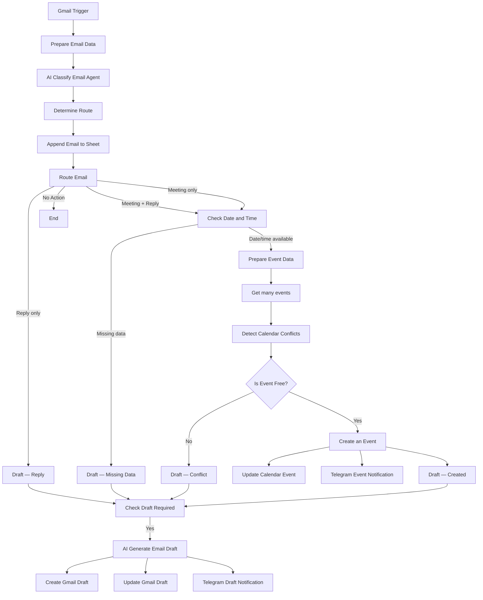

# AI Email Assistant — n8n

AI Email Assistant is an automated assistant for processing incoming emails for an IT freelancer. The system analyzes emails, determines whether a reply is needed, helps organize work meetings, creates reply drafts in Gmail, and stores processing history in Google Sheets.

The workflow is built in n8n using the GPT-4o-mini AI model via OpenRouter and integrations with Gmail, Google Calendar, Google Sheets, and Telegram.

---

# 1. Version History

| Version | Author | Changes | Download |
| --- | --- | --- | --- |
| [v1.0](https://github.com/acvetochka/ai-email-automation/tree/v1.0) | [Alona Kuznietsova](https://github.com/acvetochka) | Initial implementation of the AI Email Assistant MVP | [Download v1.0](https://github.com/acvetochka/ai-email-automation/releases#release-v1.0) |
| [v1.1](https://github.com/acvetochka/ai-email-automation/tree/v1.1) | [Alona Kuznietsova](https://github.com/acvetochka) | Telegram notifications, improved email classification and reply generation | [Download v1.1](https://github.com/acvetochka/ai-email-automation/releases#release-v1.1) |
| [v1.2](https://github.com/acvetochka/ai-email-automation/tree/v1.2) | [Alona Kuznietsova](https://github.com/acvetochka) | Improved meeting date and time detection | [Download v1.2](https://github.com/acvetochka/ai-email-automation/releases#release-v1.2) |
| [v1.3](https://github.com/acvetochka/ai-email-automation/tree/v1.3) | [Alona Kuznietsova](https://github.com/acvetochka) | Extended classification, spam detection, Google Sheets integration | [Download v1.3](https://github.com/acvetochka/ai-email-automation/releases#release-v1.3) |
| [v1.4](https://github.com/acvetochka/ai-email-automation/tree/v1.4) | [Alona Kuznietsova](https://github.com/acvetochka) | Sequential logging, node renaming, workflow documentation | [Download v1.4](https://github.com/acvetochka/ai-email-automation/releases#release-v1.4) |

---

# 2. Overview: What the Workflow Does

**Process name:**  
AI Email Assistant — Automated Email Assistant.

**Business task description:**  
Automate the analysis and initial processing of incoming work-related emails, prepare replies, and organize meetings while reducing the time spent manually sorting emails.

**What the process does:**

- Retrieves new Gmail messages and analyzes their content using AI.
- Determines the email category, whether a reply is needed, and whether the message contains a meeting proposal.
- Checks availability in Google Calendar and creates events if there are no conflicts.
- Generates reply drafts in Gmail, stores processing results in Google Sheets, and sends notifications via Telegram.

**Main email categories:**

| Category | Description |
| --- | --- |
| `question` | Work-related questions, requests, complaints, and proposals |
| `meeting` | Meeting scheduling or confirmation |
| `information` | Informational messages |
| `advertising` | Advertising and marketing newsletters |
| `auto_reply` | Automated replies |
| `spam` | Spam, phishing, and suspicious messages |
| `other` | Other emails and requests outside the professional area of expertise |

**Important limitations:**

- The assistant operates within the professional context of an IT freelancer: web development, software solutions, and business process automation.
- It does not provide legal, medical, financial, psychological, or other non-professional advice.
- It only creates email drafts in Gmail. Emails are never sent automatically.
- A calendar event is created only when the required date and time information is available and there are no scheduling conflicts.

---

# 3. Logic and Architecture

## 3.1. General Process Diagram

**Operating principle:** Each incoming email is first classified and logged in Google Sheets. Only after the `Append Email to Sheet` node has completed successfully does routing and further processing begin.

## 3.2. Main Processing Stages

**1. Email retrieval and preparation**

- `Gmail Trigger` — checks Gmail for new emails every minute.
- `Prepare Email Data` — creates a structured data set containing the email ID, subject, body, sender, sender name, and received date.

**2. AI classification**

- `AI Classify Email Agent` — analyzes the email and determines its category, whether a reply is needed, and whether it contains a meeting.
- `Structured Output Parser` — validates the AI result against the specified JSON schema.
- `Determine Route` — determines the processing route and the corresponding Google Sheets tab.

**3. Initial logging**

- `Append Email to Sheet` — creates the initial record in Google Sheets.
- Email data and classification results are stored.
- The `Route Email` node starts only after this step.

**4. Meeting processing**

- `isDateAndTimeExist` — checks whether the date and time are available.
- `Prepare Event Data` — prepares the meeting start and end dates, participant, and timezone.
- `Get many events` — retrieves calendar events within the specified time range.
- `Detect Calendar Conflicts` — identifies conflicting events.
- `isEventFree` — checks the result.
- `Create an Event` — creates a Google Calendar event if the time slot is available.
- `Update Calendar Event` — records information about the created event in Google Sheets.
- `Telegram - Event Created Notification` — sends a notification about the created event.

If the date or time is missing, the `Draft — Missing Data` context is created. If a conflict is detected, the `Draft — Conflict` context is used.

**5. Reply draft generation**

- `Draft — Reply`, `Draft — Missing Data`, `Draft — Conflict`, and `Draft — Created` — prepare the context for the corresponding scenario.
- `isDraftRequired` — determines whether a draft is needed.
- `AI Generate Email Draft` — generates a reply based on the original email and processing context.
- `Create Gmail Draft` — creates a draft in Gmail.
- `Structured Output Parser1` — validates the generated output structure.
- `Update Gmail Draft` — saves the reply text in Google Sheets.
- `Telegram - Draft Created Notification` — sends a notification containing the draft subject, recipient, and text.

**6. Processing completion**

If no reply is needed, the workflow finishes after initial logging. If an event or draft is created, the corresponding results are saved in Google Sheets and notifications are sent via Telegram.

## 3.3. Key Node Description

| Node name | Type | Purpose | Input data | Output data |
| --- | --- | --- | --- | --- |
| Gmail Trigger | Gmail Trigger | Retrieves new emails | Gmail Inbox | Incoming email data |
| Prepare Email Data | Set | Prepares email data | Gmail data | Structured email data |
| AI Classify Email Agent | AI Agent | Classifies the email | Subject, body, date | Email type, reply and meeting indicators |
| Structured Output Parser | Output Parser | Validates the classification structure | AI result | Validated JSON |
| Determine Route | Set | Determines the route and target sheet | Classification result | `route`, `xls_list` |
| Append Email to Sheet | Google Sheets | Creates the initial record | Email data and classification | Record in the corresponding sheet |
| Route Email | Switch | Routes emails to processing scenarios | `route` | Corresponding workflow branch |
| Prepare Event Data | Set | Prepares meeting parameters | Date, time, duration, sender | Event data |
| Get many events | Google Calendar | Retrieves events for conflict checking | Time interval | List of events |
| Detect Calendar Conflicts | Code | Detects scheduling conflicts | Calendar events | Time availability indicator |
| Create an Event | Google Calendar | Creates a meeting | Date, time, title, participant | Created event data |
| Update Calendar Event | Google Sheets | Updates the meeting record | Event data and Email ID | Event link and details in the sheet |
| AI Generate Email Draft | AI Agent | Generates a reply | Original email and scenario context | Status, subject, and reply text |
| Create Gmail Draft | Gmail Tool | Creates an email draft | Recipient, subject, text | Gmail draft |
| Update Gmail Draft | Google Sheets | Saves the reply text | Email ID and draft text | Updated record |
| Telegram Notifications | Telegram | Sends result notifications | Event or draft data | Telegram notification |

---

# 4. Prompts and Models

The workflow uses two AI agents. Both operate with the `openai/gpt-4o-mini` model via OpenRouter.

## 4.1. AI Classify Email Agent

**Purpose:** Analyze incoming emails, determine their category, identify whether a reply is needed, and extract work meeting details.

**Main functions:**

- Determine the email type.
- Identify whether a reply is needed.
- Detect meeting proposals.
- Extract the meeting title, date, time, and duration.
- Interpret relative dates based on the email's received date.
- Follow the professional scope of an IT freelancer.

**Model:** `openai/gpt-4o-mini` via OpenRouter.

**Parameters:** No additional model parameters are specified in `options`; default settings are used.

**Output format:** Structured JSON with the following fields:

- `email_type`
- `needs_reply`
- `is_meeting`
- `event_title`
- `event_date`
- `event_time`
- `event_duration_minutes`

**System prompt:** [AI Classify Email Agent — System Prompt](https://github.com/acvetochka/ai-email-automation/blob/main/AI-Agent1-prompt-v1.3.md)

## 4.2. AI Generate Email Draft

**Purpose:** Generate professional reply drafts for incoming work-related emails.

**Main functions:**

- Generate a reply in the language of the original email.
- Maintain a professional and polite tone.
- Handle standard requests.
- Ask for missing meeting date or time details.
- Respond to calendar conflicts.
- Confirm scheduled meetings and answer additional questions.
- Generate the draft subject and body.

**Model:** `openai/gpt-4o-mini` via OpenRouter.

**Parameters:** No additional model parameters are specified in `options`; default settings are used.

**Tool:** `Create Gmail Draft` — creates a draft in Gmail.

**Output format:** Structured JSON with the following fields:

- `status`
- `message`
- `subject`
- `text`

**System prompt:** [AI Generate Email Draft — System Prompt](https://github.com/acvetochka/ai-email-automation/blob/main/AI-Agent2-prompt-v1.3.md)

**Rationale for model and parameter selection:**

GPT-4o-mini is used for both AI agents via OpenRouter. The model handles text message classification, structured data extraction, and reply generation. Using a single model for both tasks simplifies workflow configuration and maintenance.

---

# 5. Dependencies and Configuration

## 5.1. External Services and Credentials

| Service | Credentials in n8n | Account | Required permissions |
| --- | --- | --- | --- |
| Gmail | `180926_Kuznietsova_Gmail` | Connected Gmail account | Retrieve emails, read messages, create drafts |
| Google Calendar | `180626_Kuznietsova_Google_Calendar` | Connected Google account | Read calendar events, create events |
| Google Sheets | `180926_Kuznietsova_Google Sheets` | Connected Google account | Append and update spreadsheet rows |
| Telegram | `180926_Kuznietsova_Telegram` | Connected Telegram bot | Send messages to the designated chat |
| OpenRouter | `180926_Kuznietsova_OpenRouter` | OpenRouter account | API access and use of the GPT-4o-mini model |

*Credential secrets, API keys, and tokens are not stored in this documentation.*

## 5.2. Main Workflow Settings

| Parameter | Value |
| --- | --- |
| Platform | n8n Community Edition |
| Workflow timezone | `Europe/Berlin` |
| Gmail Trigger | Checks every minute |
| AI Provider | OpenRouter |
| AI Model | `openai/gpt-4o-mini` |
| Calendar | Google Calendar |
| Database / Logging | Google Sheets |
| Notifications | Telegram |
| Email processing | Gmail |
| Email sending | Not used — only drafts are created |

## 5.3. Google Sheets

**Spreadsheet name:** `AI_Email_Assistant_Email_Database`

The following sheets are used to categorize emails:

| Email type | Sheet |
| --- | --- |
| `question` | Main |
| `meeting` | Main |
| `information` | Info |
| `advertising` | Advertising |
| `auto_reply` | Info |
| `spam` | Spam |
| `other` | Other |

**Record structure:**

| Field | Purpose |
| --- | --- |
| `Email_id` | Unique email identifier |
| `Date` | Received date |
| `Name` | Sender name |
| `Email` | Sender email address |
| `Subject` | Email subject |
| `Body` | Email body |
| `Type` | Email category |
| `Needs reply` | Whether a reply is required |
| `Is meeting` | Whether the email contains a meeting |
| `Reply` | Generated reply text |
| `Event` | Google Calendar event link |
| `Event title` | Meeting title |
| `Event date` | Meeting date |
| `Event time` | Meeting start time |
| `Event duration` | Duration in minutes |

**Data storage logic:**

1. `Append Email to Sheet` creates the initial record after email classification.
2. `Update Calendar Event` updates the corresponding record after an event is created.
3. `Update Gmail Draft` adds the generated reply text to the corresponding record.

The `Email_id` field is used to locate the record.

## 5.4. Setup Requirements

Before running the workflow:

1. Import the workflow JSON file into n8n.
2. Connect your own Gmail, Google Calendar, Google Sheets, Telegram, and OpenRouter credentials.
3. Check that the correct calendar and Google Sheets spreadsheet are selected.
4. Make sure all required sheets and columns exist in Google Sheets.
5. Verify that the sheet names match the values configured in `Determine Route`.
6. Configure the Telegram bot and target chat.
7. Test both AI agents and Gmail draft creation.
8. Test all main processing scenarios before activating the workflow.

---

# 6. Important Features and Limitations

- Meeting dates are determined based on the original email's received date, not the workflow execution date.
- `Europe/Berlin` is used for date and time interpretation.
- If meeting date or time details are missing or ambiguous, the AI must not invent them.
- If a calendar conflict is detected, the event is not created. Instead, a draft is prepared asking the sender to agree on another time.
- Information about conflicting calendar events is not disclosed to the sender.
- The initial email record in Google Sheets is created before routing begins.
- Subsequent record updates are performed using `Email_id`.
- The AI agent does not send emails automatically — all replies remain Gmail drafts.
- Telegram is used only for internal notifications about processing results.

---

# 7. Workflow Structure

The workflow consists of the following node groups:

| Group | Main nodes |
| --- | --- |
| Email retrieval | Gmail Trigger, Prepare Email Data |
| AI classification | AI Classify Email Agent, Structured Output Parser |
| Routing | Determine Route, Route Email |
| Logging | Append Email to Sheet, Update Calendar Event, Update Gmail Draft |
| Calendar processing | isDateAndTimeExist, Prepare Event Data, Get many events, Detect Calendar Conflicts, isEventFree, Create an Event |
| Reply preparation | Draft — Created, Draft — Conflict, Draft — Missing Data, Draft — Reply, isDraftRequired |
| AI generation | AI Generate Email Draft, Structured Output Parser1, Create Gmail Draft |
| Notifications | Telegram - Event Created Notification, Telegram - Draft Created Notification |

Sticky Notes have also been added to the workflow to explain the purpose and logic of its main node groups.

---

**Project:** AI Email Assistant  
**Platform:** n8n Community Edition  
**AI Provider:** OpenRouter  
**AI Model:** GPT-4o-mini  
**Timezone:** Europe/Berlin  
**Current version:** 1.4
