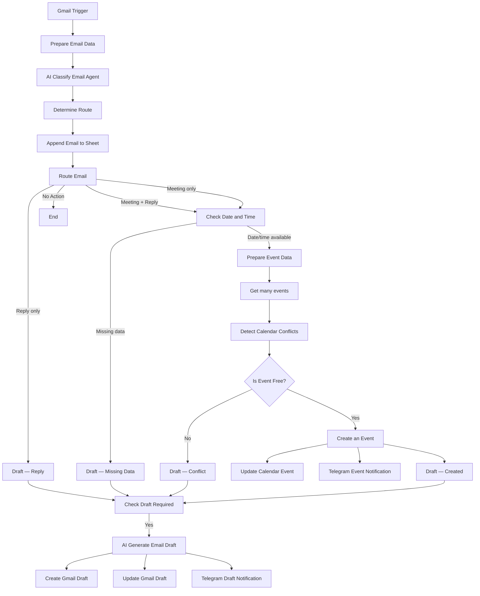

# AI Email Assistant — n8n

AI Email Assistant — это автоматизированный помощник для обработки входящей электронной почты IT-фрилансера. Система анализирует письма, определяет необходимость ответа, помогает организовывать рабочие встречи, создаёт черновики ответов в Gmail и сохраняет историю обработки в Google Sheets.

Workflow построен в n8n с использованием AI-модели GPT-4o-mini через OpenRouter и интеграций Gmail, Google Calendar, Google Sheets и Telegram.

---

# 1. История версий

| Версия | Автор | Что изменилось | Загрузка |
| --- | --- | --- | --- |
| [v1.0](https://github.com/acvetochka/ai-email-automation/tree/v1.0) | [Alona Kuznietsova](https://github.com/acvetochka) | первоначальная реализация AI Email Assistant MVP | [Скачать v1.0](https://github.com/acvetochka/ai-email-automation/releases#release-v1.0) |
| [v1.1](https://github.com/acvetochka/ai-email-automation/tree/v1.1) | [Alona Kuznietsova](https://github.com/acvetochka) | Telegram-уведомления, улучшение классификации и генерации ответов | [Скачать v1.1](https://github.com/acvetochka/ai-email-automation/releases#release-v1.1) |
| [v1.2](https://github.com/acvetochka/ai-email-automation/tree/v1.2) | [Alona Kuznietsova](https://github.com/acvetochka) | уточнение определения дат и времени встреч | [Скачать v1.2](https://github.com/acvetochka/ai-email-automation/releases#release-v1.2) |
| [v1.3](https://github.com/acvetochka/ai-email-automation/tree/v1.3) | [Alona Kuznietsova](https://github.com/acvetochka) | расширенная классификация, обнаружение спама, интеграция Google Sheets | [Скачать v1.3](https://github.com/acvetochka/ai-email-automation/releases#release-v1.3) |
| [v1.4](https://github.com/acvetochka/ai-email-automation/tree/v1.4) | [Alona Kuznietsova](https://github.com/acvetochka) | последовательное журналирование, переименование узлов, документация workflow | [Скачать v1.4](https://github.com/acvetochka/ai-email-automation/releases#release-v1.4) |

---

# 2. Обзор: что делает сценарий

**Название процесса:**  
AI Email Assistant — автоматизированный помощник для электронной почты.

**Описание бизнес-задачи:**  
Автоматизировать анализ и предварительную обработку входящих рабочих писем, подготовку ответов и организацию встреч, сокращая время на ручную сортировку электронной почты.

**Что делает процесс:**

- Получает новые письма Gmail и анализирует их содержание с помощью AI.
- Определяет категорию письма, необходимость ответа и наличие предложения о встрече.
- Проверяет доступность времени в Google Calendar и создаёт события, если нет конфликтов.
- Генерирует черновики ответов в Gmail, сохраняет результаты в Google Sheets и отправляет уведомления в Telegram.

**Основные категории писем:**

| Категория | Описание |
| --- | --- |
| `question` | Рабочие вопросы, запросы, жалобы и предложения |
| `meeting` | Организация или подтверждение встречи |
| `information` | Информационные сообщения |
| `advertising` | Рекламные и маркетинговые рассылки |
| `auto_reply` | Автоматические ответы |
| `spam` | Спам, фишинг и подозрительные сообщения |
| `other` | Другие письма и запросы вне профессиональной компетенции |

**Важные ограничения:**

- Ассистент работает в контексте профессиональной деятельности IT-фрилансера: веб-разработка, программные решения и автоматизация бизнес-процессов.
- Не предоставляет юридические, медицинские, финансовые, психологические и другие непрофильные консультации.
- Создаёт только черновики писем в Gmail. Автоматическая отправка электронной почты не выполняется.
- Событие календаря создаётся только при наличии необходимых данных о дате и времени и отсутствии конфликтов.

---

# 3. Логика и архитектура

## 3.1. Общая схема процесса

**Принцип работы:** каждое новое письмо сначала проходит классификацию и записывается в Google Sheets. Только после успешного выполнения узла `Append Email to Sheet` запускается маршрутизация и дальнейшая обработка.

## 3.2. Основные этапы

**1. Получение и подготовка письма**

- `Gmail Trigger` — проверяет Gmail на наличие новых писем каждую минуту.
- `Prepare Email Data` — формирует структурированный набор данных: ID письма, тему, текст, отправителя, имя и дату получения.

**2. AI-классификация**

- `AI Classify Email Agent` — анализирует письмо и определяет его категорию, необходимость ответа и наличие встречи.
- `Structured Output Parser` — проверяет структуру результата AI в соответствии с заданной JSON-схемой.
- `Determine Route` — определяет маршрут обработки и соответствующий лист Google Sheets.

**3. Первоначальное журналирование**

- `Append Email to Sheet` — создаёт первоначальную запись в Google Sheets.
- Сохраняются данные письма и результаты классификации.
- После этого запускается `Route Email`.

**4. Обработка встреч**

- `isDateAndTimeExist` — проверяет наличие даты и времени.
- `Prepare Event Data` — формирует дату начала и окончания встречи, данные участника и часовой пояс.
- `Get many events` — получает события календаря за заданный временной интервал.
- `Detect Calendar Conflicts` — определяет наличие конфликтующих событий.
- `isEventFree` — проверяет результат.
- `Create an Event` — создаёт событие в Google Calendar, если время свободно.
- `Update Calendar Event` — записывает информацию о созданном событии в Google Sheets.
- `Telegram - Event Created Notification` — отправляет уведомление о созданном событии.

Если дата или время отсутствуют, формируется контекст `Draft — Missing Data`. Если обнаружен конфликт, используется `Draft — Conflict`.

**5. Генерация черновика ответа**

- `Draft — Reply`, `Draft — Missing Data`, `Draft — Conflict`, `Draft — Created` — формируют контекст соответствующего сценария.
- `isDraftRequired` — определяет, нужен ли черновик.
- `AI Generate Email Draft` — генерирует ответ на основе исходного письма и контекста обработки.
- `Create Gmail Draft` — создаёт черновик в Gmail.
- `Structured Output Parser1` — проверяет структуру результата генерации.
- `Update Gmail Draft` — сохраняет текст ответа в Google Sheets.
- `Telegram - Draft Created Notification` — отправляет уведомление о созданном черновике, его теме, получателе и тексте.

**6. Завершение обработки**

Если ответ не требуется, workflow завершает обработку после первоначального журналирования. Если создано событие или черновик, соответствующие результаты сохраняются в Google Sheets и отправляются через Telegram.

## 3.3. Описание ключевых узлов

| Название узла | Тип | Назначение | Входные данные | Выходные данные |
| --- | --- | --- | --- | --- |
| Gmail Trigger | Gmail Trigger | Получение новых писем | Gmail Inbox | Данные входящего письма |
| Prepare Email Data | Set | Подготовка данных письма | Данные Gmail | Структурированные данные письма |
| AI Classify Email Agent | AI Agent | Классификация письма | Тема, текст, дата | Тип письма, признаки необходимости ответа и встречи |
| Structured Output Parser | Output Parser | Проверка структуры классификации | Результат AI | Валидированный JSON |
| Determine Route | Set | Определение маршрута и листа | Результат классификации | `route`, `xls_list` |
| Append Email to Sheet | Google Sheets | Создание первоначальной записи | Данные письма и классификация | Запись в соответствующем листе |
| Route Email | Switch | Распределение писем по сценариям | `route` | Соответствующая ветка workflow |
| Prepare Event Data | Set | Подготовка параметров встречи | Дата, время, продолжительность, отправитель | Данные события |
| Get many events | Google Calendar | Получение событий для проверки | Временной интервал | Список событий |
| Detect Calendar Conflicts | Code | Обнаружение конфликтов | События календаря | Признак доступности времени |
| Create an Event | Google Calendar | Создание встречи | Дата, время, название, участник | Данные созданного события |
| Update Calendar Event | Google Sheets | Обновление записи о встрече | Данные события и Email ID | Ссылка и параметры события в таблице |
| AI Generate Email Draft | AI Agent | Генерация ответа | Исходное письмо и контекст сценария | Статус, тема и текст ответа |
| Create Gmail Draft | Gmail Tool | Создание черновика | Получатель, тема, текст | Черновик Gmail |
| Update Gmail Draft | Google Sheets | Сохранение текста ответа | Email ID и текст черновика | Обновлённая запись |
| Telegram Notifications | Telegram | Уведомления о результатах | Данные события или черновика | Уведомление в Telegram |

---

# 4. Промпты и модели

В workflow используются два AI-агента. Оба работают с моделью `openai/gpt-4o-mini` через OpenRouter.

## 4.1. AI Classify Email Agent

**Назначение:** анализ входящих писем, определение категории, необходимости ответа и параметров рабочей встречи.

**Основные функции:**

- Определение типа письма.
- Определение необходимости ответа.
- Обнаружение предложений о встрече.
- Извлечение названия, даты, времени и продолжительности встречи.
- Интерпретация относительных дат на основе даты получения письма.
- Соблюдение профессиональной области компетенции IT-фрилансера.

**Модель:** `openai/gpt-4o-mini` через OpenRouter.

**Параметры:** дополнительные параметры модели в `options` не заданы; используются настройки по умолчанию.

**Формат результата:** структурированный JSON со следующими полями:

- `email_type`
- `needs_reply`
- `is_meeting`
- `event_title`
- `event_date`
- `event_time`
- `event_duration_minutes`

**Системный промпт:** [AI Classify Email Agent — System Prompt](https://github.com/acvetochka/ai-email-automation/blob/main/AI-Agent1-prompt-v1.3.md)

## 4.2. AI Generate Email Draft

**Назначение:** создание профессиональных черновиков ответов на входящие рабочие письма.

**Основные функции:**

- Генерация ответа на языке исходного письма.
- Соблюдение профессионального и вежливого стиля.
- Обработка обычных запросов.
- Уточнение отсутствующей даты или времени встречи.
- Реакция на конфликты в календаре.
- Подтверждение созданной встречи и ответы на дополнительные вопросы.
- Формирование темы и текста черновика.

**Модель:** `openai/gpt-4o-mini` через OpenRouter.

**Параметры:** дополнительные параметры модели в `options` не заданы; используются настройки по умолчанию.

**Инструмент:** `Create Gmail Draft` — создание черновика в Gmail.

**Формат результата:** структурированный JSON со следующими полями:

- `status`
- `message`
- `subject`
- `text`

**Системный промпт:** [AI Generate Email Draft — System Prompt](https://github.com/acvetochka/ai-email-automation/blob/main/AI-Agent2-prompt-v1.3.md)

**Обоснование выбора модели и параметров:**

GPT-4o-mini используется для обоих AI-агентов через OpenRouter. Модель применяется для классификации текстовых сообщений, извлечения структурированных данных и генерации ответов. Использование одной модели для обеих задач упрощает конфигурацию и обслуживание workflow.

---

# 5. Зависимости и настройки

## 5.1. Внешние сервисы и credentials

| Сервис | Credentials в n8n | Учётная запись | Необходимые права |
| --- | --- | --- | --- |
| Gmail | `180926_Kuznietsova_Gmail` | Подключённый аккаунт Gmail | Получение писем, чтение сообщений, создание черновиков |
| Google Calendar | `180626_Kuznietsova_Google_Calendar` | Подключённый аккаунт Google | Чтение событий календаря, создание событий |
| Google Sheets | `180926_Kuznietsova_Google Sheets` | Подключённый аккаунт Google | Добавление и обновление строк в таблице |
| Telegram | `180926_Kuznietsova_Telegram` | Подключённый Telegram-бот | Отправка сообщений в указанный чат |
| OpenRouter | `180926_Kuznietsova_OpenRouter` | Аккаунт OpenRouter | Доступ к API и использование модели GPT-4o-mini |

*Секретные значения credentials, API-ключи и токены в документации не хранятся.*

## 5.2. Основные настройки workflow

| Параметр | Значение |
| --- | --- |
| Платформа | n8n Community Edition |
| Часовой пояс workflow | `Europe/Berlin` |
| Gmail Trigger | Проверка каждую минуту |
| AI Provider | OpenRouter |
| AI Model | `openai/gpt-4o-mini` |
| Calendar | Google Calendar |
| Database / Logging | Google Sheets |
| Notifications | Telegram |
| Email processing | Gmail |
| Email sending | Не используется — создаются только черновики |

## 5.3. Google Sheets

**Название таблицы:** `AI_Email_Assistant_Email_Database`

Для распределения писем используются следующие листы:

| Тип письма | Лист |
| --- | --- |
| `question` | Main |
| `meeting` | Main |
| `information` | Info |
| `advertising` | Advertising |
| `auto_reply` | Info |
| `spam` | Spam |
| `other` | Other |

**Структура записи:**

| Поле | Назначение |
| --- | --- |
| `Email_id` | Уникальный идентификатор письма |
| `Date` | Дата получения |
| `Name` | Имя отправителя |
| `Email` | Адрес отправителя |
| `Subject` | Тема письма |
| `Body` | Текст письма |
| `Type` | Категория письма |
| `Needs reply` | Требуется ли ответ |
| `Is meeting` | Содержит ли письмо информацию о встрече |
| `Reply` | Сгенерированный текст ответа |
| `Event` | Ссылка на событие Google Calendar |
| `Event title` | Название встречи |
| `Event date` | Дата встречи |
| `Event time` | Время начала |
| `Event duration` | Продолжительность в минутах |

**Логика сохранения:**

1. `Append Email to Sheet` создаёт первоначальную запись после классификации письма.
2. `Update Calendar Event` обновляет соответствующую запись после создания события.
3. `Update Gmail Draft` добавляет текст сгенерированного ответа в соответствующую запись.

Для поиска записи используется `Email_id`.

## 5.4. Требования к настройке

Перед запуском workflow необходимо:

1. Импортировать JSON-файл workflow в n8n.
2. Подключить собственные credentials Gmail, Google Calendar, Google Sheets, Telegram и OpenRouter.
3. Проверить правильность выбранного календаря и Google Sheets.
4. Убедиться, что в Google Sheets созданы все необходимые листы и столбцы.
5. Проверить соответствие названий листов значениям в `Determine Route`.
6. Настроить Telegram-бота и целевой чат.
7. Проверить работу обоих AI-агентов и создание черновиков.
8. Протестировать все основные сценарии перед активацией workflow.

---

# 6. Важные особенности и ограничения

- Дата встречи определяется на основе даты получения исходного письма, а не даты запуска workflow.
- Для интерпретации дат и времени используется `Europe/Berlin`.
- Если дата или время встречи отсутствуют либо неоднозначны, AI не должен их придумывать.
- Если в календаре обнаружен конфликт, событие не создаётся, а формируется черновик с просьбой согласовать другое время.
- Информация о конфликтующих событиях не раскрывается отправителю.
- Первоначальная запись письма в Google Sheets создаётся до запуска маршрутизации.
- Последующее обновление записи выполняется по `Email_id`.
- AI-агент не отправляет письма самостоятельно — все ответы остаются черновиками Gmail.
- Telegram используется только для внутренних уведомлений о результатах обработки.

---

# 7. Структура workflow

В workflow используются следующие группы узлов:

| Группа | Основные узлы |
| --- | --- |
| Получение писем | Gmail Trigger, Prepare Email Data |
| AI-классификация | AI Classify Email Agent, Structured Output Parser |
| Маршрутизация | Determine Route, Route Email |
| Журналирование | Append Email to Sheet, Update Calendar Event, Update Gmail Draft |
| Работа с календарём | isDateAndTimeExist, Prepare Event Data, Get many events, Detect Calendar Conflicts, isEventFree, Create an Event |
| Подготовка ответа | Draft — Created, Draft — Conflict, Draft — Missing Data, Draft — Reply, isDraftRequired |
| AI-генерация | AI Generate Email Draft, Structured Output Parser1, Create Gmail Draft |
| Уведомления | Telegram - Event Created Notification, Telegram - Draft Created Notification |

В workflow также добавлены Sticky Notes с пояснениями назначения и логики основных групп узлов.

---

**Проект:** AI Email Assistant  
**Платформа:** n8n Community Edition  
**AI Provider:** OpenRouter  
**AI Model:** GPT-4o-mini  
**Timezone:** Europe/Berlin  
**Текущая версия:** 1.4
